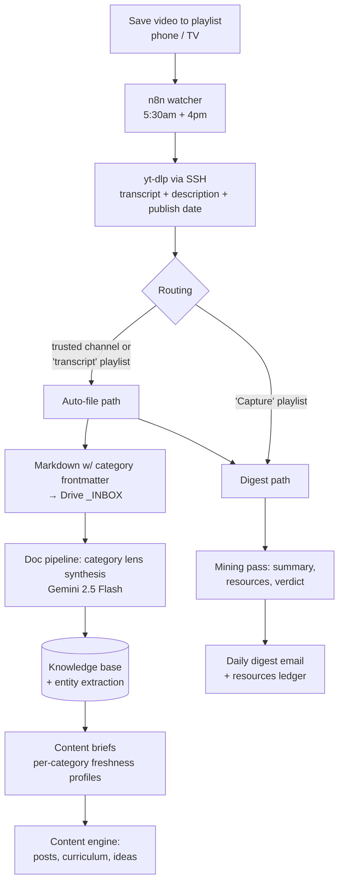

# YouTube → Knowledge Base Capture Pipeline

**Save a YouTube video from your phone or TV. Wake up to a summary, every resource it mentioned, and a knowledge base that filed the good stuff on its own.**

An n8n-based pipeline that turns YouTube playlists into a hands-free research capture system. Saving a video to a playlist *is* the capture action — everything downstream is automatic: transcript extraction, AI summarization with domain-specific "lenses," resource mining, a daily digest email, and structured filing into a personal knowledge base.

Built to solve a real problem: I do a lot of research on YouTube, mostly from a phone or TV, where "I'll look into this later" historically meant "I'll never see this again."

## What a day looks like

1. Watching a video on the couch, 9pm: *this is good* → save to a playlist. That's the entire manual step.
2. **5:30am** — the watcher polls all playlists via the YouTube API, pulls transcripts and descriptions for anything new, routes each video by playlist rules.
3. **~6am** — one digest email: per-video summaries calibrated to my interests, every GitHub repo / tool / link extracted (from the description, where links actually live), and a verdict per video.
4. Trusted creators' videos are **also filed automatically** into the knowledge base, synthesized through a category-specific lens.
5. Weekly: a compiled **content brief** per topic area — dated claims, attributed creator takes, mapped consensus, and pre-vetted contrarian content angles.

## Architecture



### The control surface: playlists

| Playlist | Behavior |
|---|---|
| `Capture` | Mined + surfaced in the digest. Nothing auto-filed — you decide from the email |
| `transcript` | Full transcript auto-filed to the knowledge base + digest entry marked `[auto-filed]` |
| Subject playlists | Tags only — the playlist name becomes the video's `category`, selecting the synthesis lens |
| Trusted channels (config sheet) | Their videos auto-file when saved to *any* playlist, with a per-creator default category |

A Google Sheet is the entire configuration layer: playlists → modes, trusted channels → categories, a dedup ledger, and a resource tracker with triage statuses.

### Category lenses

The synthesis prompt is category-aware. Each content lens extracts two layers:

- **Layer 1 — the material:** domain-specific facts (for AI content: tools, workflow patterns, capability claims; for sports: storylines, stats, verbatim quotes; for legal: process explanations, client questions)
- **Layer 2 — the discourse:** the creator's take *attributed by name*, where they sit relative to consensus, and open debates — so opinion writing can position against the actual conversation

Untagged documents get **classify-then-extract**: the model picks the lens and declares the category in the same call — no hardcoded default.

### Freshness-aware content briefs

Every claim carries the video's **publish date** (not capture date), so backlog content can't masquerade as news. Brief compilation uses per-category profiles:

- `ai-systems`: 7-day window — anything older than ~2 weeks is labeled historical context
- `womens-sports`: 30-day window in three horizons — *Write now* (≤72h, stale in 2 days), *Current storylines* (≤2 weeks), *Standing issues* (league economics, CBA — writable all month)

## Stack

- **n8n** (self-hosted) — orchestration; two workflows + a patched document pipeline
- **yt-dlp** — transcripts + metadata, executed on the VPS host via n8n's SSH node
- **Gemini 2.5 Flash** via OpenRouter — mining + lens synthesis (~$0.005–0.01/video)
- **Google Sheets** — configuration, dedup ledger, resource tracker
- **Google Drive** — file transport between pipeline stages
- **Postgres + PostgREST** — knowledge base (thoughts + entity extraction)
- **Node.js** — content-brief compiler with category freshness profiles

## Repo contents

```
workflows/
  watcher-workflow.json        # the daily watcher + digest (import into n8n)
  batch-backlog-workflow.json  # one-time backlog processor (Sheet-driven, resumable)
docs/
  design.md                    # full design rationale, capture tiers, decisions
  synthesis-lenses.md          # the category-lens prompt architecture (2 nodes)
  setup-watcher.md             # step-by-step setup
  setup-batch.md               # backlog processing setup
```

All IDs, keys, and paths are placeholders (`YOUR_SHEET_ID`, `YOUR_OPENROUTER_API_KEY`, …) — search for `YOUR_` after importing.

## Hard-won implementation notes

Things that will bite you if you build this yourself:

1. **YouTube bot-blocks datacenter IPs.** yt-dlp on a VPS gets "Sign in to confirm you're not a bot." Fix: export browser cookies (from an incognito session you then close, so they don't rotate) + install a JS runtime (deno) for player parsing. Cookies expire every few weeks — the system's one recurring maintenance task.
2. **n8n's Execute Command node may be unavailable** on your instance. The SSH node (to the Docker *host*) is the durable alternative — it also survives container auto-updates, which would wipe any yt-dlp installed inside the container.
3. **`$('node').all()` inside an n8n loop returns only the last iteration.** Collecting across a `SplitInBatches` loop requires iterating `runIndex` explicitly. My first digest email contained exactly one video because of this.
4. **YouTube's Watch Later playlist is invisible to the API** — a long-standing limitation. Treat it as a TV-side inbox and move keepers to a real playlist from your phone.
5. **Publish date ≠ capture date.** If your recency logic uses ingestion timestamps, a backlog import makes six-month-old videos look like today's news. Carry the upload date through every pipeline stage.
6. **Update-Row nodes with empty mapped fields overwrite cells with blanks** in the Google Sheets node — delete unused mappings, don't leave them empty.

## License

MIT
